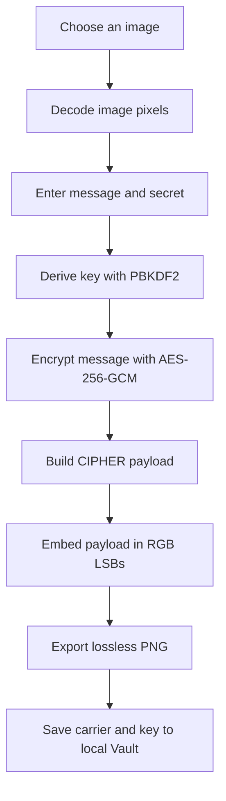

<div align="center">

# CIPHER
### Beyond Visible Information

**Hide encrypted information inside ordinary-looking images. Inspect the metadata around it. Learn the science behind every layer.**

<p>
  <a href="https://cypher.steganography.workers.dev"><strong>🚀 Live Demo</strong></a>
  &nbsp; · &nbsp;
  <a href="docs/PROJECT_DOCUMENTATION.md">📚 Full Documentation</a>
  &nbsp; · &nbsp;
  <a href="docs/CLOUDFLARE_DEPLOYMENT.md">☁️ Deploy with Cloudflare</a>
</p>

<p>
  
  
  
  
  
</p>

</div>

---

## ✦ What is CIPHER?

CIPHER is a browser-based image steganography and metadata toolkit that combines **cryptography** with **digital steganography**. It encrypts a message first, then hides the resulting ciphertext inside the pixel data of an image using the **RGB Least Significant Bit (LSB)** technique.

It is also a learning environment: explore the tools, inspect image metadata, experiment with payloads, and read focused explanations of the technologies used under the hood.

> **The central idea:** encryption makes information unreadable; steganography makes the presence of information less obvious. CIPHER demonstrates how the two ideas can be combined.

<div align="center">

| 🔐 Encrypt | 🖼️ Hide | 🔎 Inspect | 🧹 Clean | 📖 Learn |
|:---:|:---:|:---:|:---:|:---:|
| AES-256-GCM | RGB LSB | Image metadata | PNG metadata tools | Interactive lessons |

</div>

## ✨ Features

### Steganography studio
- Encrypt messages using **AES-256-GCM** with the browser's Web Crypto API.
- Derive a 256-bit encryption key using **PBKDF2-HMAC-SHA-256** with 310,000 iterations.
- Embed the encrypted payload in RGB pixel-channel least significant bits.
- Extract and decrypt CIPHER payloads using the correct secret key.
- Accept browser-decodable image inputs and export the carrier as a **PNG** to preserve pixel values.
- Optionally write a key to the `CIPHER_SECRET_KEY` PNG metadata field. This is a convenience feature, not secure key sharing.

### Local Vault
- Automatically save generated carrier images and their associated keys in the browser's local Vault.
- Keep Vault records for **48 hours**.
- Download a stored image, copy its key, or manually delete a record.
- Store Vault data in the browser using IndexedDB. No CIPHER account is required.

### Metadata toolkit
- Inspect image dimensions and available EXIF metadata.
- Edit common descriptive PNG metadata fields.
- Remove selected supported PNG metadata chunks or remove supported ancillary metadata in bulk.
- Clear a hidden CIPHER pixel payload separately from metadata cleaning.

### Learn section
- Explore explanations of AES-GCM, PBKDF2, LSB steganography, PNG structure, Web Crypto and IndexedDB.
- Open technology topics from the app's technology section and follow relevant references.

## 🧭 How it works



To recover the message, CIPHER reads the embedded payload, validates its format, and decrypts it with the correct key. A wrong key should fail authentication rather than produce trusted plaintext.

## 🧪 Cryptographic design at a glance

| Component | Used by CIPHER | Purpose |
|---|---|---|
| Symmetric encryption | AES-256-GCM | Confidentiality and authenticated encryption |
| Key derivation | PBKDF2-HMAC-SHA-256 | Derives an encryption key from the supplied secret |
| Salt | Random 16 bytes | Makes key derivation unique per encryption |
| Initialization vector | Random 12 bytes | Required by the AES-GCM operation |
| Payload marker | `CPHR` magic/version header | Helps identify and parse CIPHER payloads |
| Steganography | RGB LSB | Stores payload bits in image pixel channels |

The implementation details and payload layout are described in the [full project documentation](docs/PROJECT_DOCUMENTATION.md).

## 🖥️ Run CIPHER on your computer

You can download the source code and run it locally. You do **not** need to deploy it or create a CIPHER account.

### 1. Install the prerequisites

- **Node.js:** use the version specified in [`.nvmrc`](.nvmrc), currently `22.23.4`.
- **npm:** included with Node.js.
- **Git:** optional, but recommended if you want to clone the repository and receive updates.
- A modern browser such as Chrome, Edge, Firefox or Safari.

Check that Node.js and npm are installed:

```bash
node --version
npm --version
```

### 2. Download the project

**Option A: Download ZIP (no Git required)**

1. Open this repository on GitHub.
2. Click the green **Code** button.
3. Select **Download ZIP**.
4. Extract the downloaded ZIP file.
5. Open the extracted `Cypher-Steganography-Project-main` folder in VS Code or your terminal.

**Option B: Clone with Git**

```bash
git clone https://github.com/YOUR_GITHUB_USERNAME/YOUR_REPOSITORY_NAME.git
cd YOUR_REPOSITORY_NAME
```

Replace the repository URL and folder name with the actual values shown on this GitHub page.

### 3. Install dependencies

Open a terminal in the project root, the folder containing `package.json`, and run:

```bash
npm ci
```

`npm ci` installs the exact dependency versions recorded in `package-lock.json`.

### 4. Start the development server

```bash
npm run dev
```

Vite prints a local address, usually:

```text
http://localhost:5173
```

Open that address in your browser. Keep the terminal running while you use the development version.

### 5. Create and preview a production build (optional)

```bash
npm run build
npm run preview
```

The production-ready static files are generated in the `dist/` folder. The preview command prints a local URL where you can inspect that build.

### Useful commands

| Command | What it does |
|---|---|
| `npm ci` | Installs locked project dependencies |
| `npm run dev` | Starts the local development server |
| `npm run build` | Creates the production build in `dist/` |
| `npm run preview` | Serves the production build locally |
| `npm run lint` | Runs ESLint checks |

## ☁️ Deploy CIPHER with Cloudflare Pages

CIPHER is a static React + Vite application, so **Cloudflare Pages** can host the built frontend without a continuously running application server.

### Cloudflare Pages build settings

| Setting | Value |
|---|---|
| Framework preset | `Vite` (if available) |
| Production branch | `main` |
| Root directory | `/` (repository root) |
| Build command | `npm run build` |
| Build output directory | `dist` |
| Environment variable | `NODE_VERSION` = `22.23.4` |

**Full walkthrough:** [Cloudflare Pages deployment guide](docs/CLOUDFLARE_DEPLOYMENT.md). It covers account setup, GitHub connection, each dashboard setting, deployment verification, custom domains, automatic updates and troubleshooting.

After deployment, replace the **Live Demo** placeholder at the top of this README with your actual `https://<project-name>.pages.dev` URL.

## 🗂️ Project structure

```text
.
├── public/                 # Public static assets and icons
├── docs/                   # Detailed project and deployment documentation
├── src/
│   ├── components/         # Reusable UI, navigation and studio components
│   ├── sections/           # Landing-page sections
│   ├── pages/              # App routes and studio pages
│   ├── lib/
│   │   ├── crypto/         # Encryption implementation
│   │   ├── steganography/  # Payload encoding and extraction
│   │   ├── image/          # PNG and metadata utilities
│   │   └── vault/          # IndexedDB Vault services
│   ├── hooks/              # Reusable React hooks
│   └── styles/             # Global styles, tokens and animations
├── index.html
├── package.json
├── package-lock.json
└── vite.config.js
```

## 🧰 Technology stack

- **Frontend:** React, JavaScript, Vite
- **Styling and UI:** Tailwind CSS, daisyUI, custom CSS
- **Navigation:** React Router
- **Motion:** Motion, Lenis
- **Cryptography:** Web Crypto API (AES-GCM and PBKDF2)
- **Image processing:** Canvas API, `ImageData`, PNG chunk utilities
- **Metadata:** `exifr` and PNG metadata utilities
- **Local persistence:** IndexedDB via `idb`

## ⚠️ Image formats and compatibility

The browser decodes supported input images into pixels. CIPHER embeds the payload into those pixels and exports a PNG carrier. PNG is lossless, which matters because lossy recompression can alter the least significant bits that contain the payload.

- JPEG, PNG, WebP, BMP and GIF are commonly decodable by modern browsers, but exact support depends on the browser.
- HEIC/HEIF and camera RAW formats are not guaranteed to decode.
- Animated formats are processed from a decoded frame; the original animation is not preserved as an animation.
- PNG receives chunk-level inspection and supported chunk-level cleaning.
- EXIF inspection for other formats depends on parser support.
- Non-PNG metadata cleaning normalizes the decoded image to PNG and does not preserve the original container metadata.
- The metadata editor writes common descriptive fields into PNG `iTXt` chunks. It does not edit every camera-specific EXIF, GPS or timestamp field.

## 🔒 Security, privacy and limitations

Please read these notes before treating CIPHER as a secure file-sharing system:

1. **Key in metadata:** `CIPHER_SECRET_KEY` is readable by anyone who has the image. Do not use it to share a secret key securely.
2. **Local Vault:** keys are stored in the browser's IndexedDB without a master-password encryption layer. The Vault is a temporary local convenience, not a secure password manager.
3. **LSB fragility:** resizing, recompression, filters, screenshots and lossy exports can corrupt the hidden payload. Preserve the downloaded PNG carrier exactly.
4. **Steganography is not invisibility:** LSB embedding does not guarantee that the presence of hidden data cannot be detected.
5. **Browser-local processing:** core image and cryptographic operations run in the browser. Optional reverse-geocoding functionality may contact an external provider when used.
6. **Educational project:** CIPHER has not undergone an independent security audit. Do not rely on it to protect high-value or safety-critical information.

## 📚 Documentation

| Document | What it covers |
|---|---|
| [Project documentation](docs/PROJECT_DOCUMENTATION.md) | Goals, architecture, cryptographic design, payload structure, image handling, metadata, Vault, privacy, limitations and testing |
| [Cloudflare deployment guide](docs/CLOUDFLARE_DEPLOYMENT.md) | Complete dashboard-based hosting walkthrough, settings, testing and troubleshooting |
| [GitHub and deployment guide](docs/GITHUB_AND_DEPLOYMENT_GUIDE.md) | Preparing a local project, GitHub repository setup and deployment workflow |

## 🤝 Contributing

Contributions, bug reports and suggestions are welcome. Before opening a pull request:

1. Create a focused branch for your change.
2. Keep changes small and explain the reason for them.
3. Run `npm ci`, `npm run lint` and `npm run build` locally.
4. Describe the manual tests you performed, especially for image encoding and decoding.

Please do not submit real private images, passwords, encryption keys or personal metadata in issues or pull requests.

## 📄 License

No open-source license has been declared in this repository yet. Until a license is added, the source remains subject to the default copyright rules; do not assume that it is free to reuse or redistribute.

---

<div align="center">

**CIPHER — Beyond Visible Information**  
*Information can be hidden in plain sight. Understanding how is the point.*

</div>
